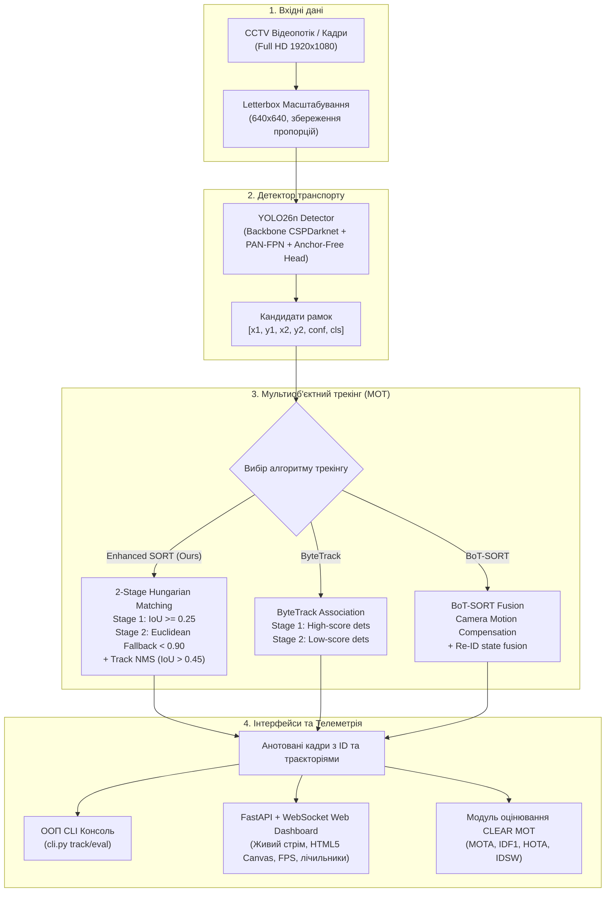

# 🚗 CCTV Traffic Vehicle Detection & Multi-Object Tracking System

---


## 🎯 Анотація та Мета роботи

Проєкт присвячено розробці, дослідженню та практичній реалізації високоефективного конвеєра комп'ютерного зору для виявлення та мультиоб'єктного супроводу (Multi-Object Tracking, MOT) транспортних засобів у режимі реального часу за відеопотоками стаціонарних дорожніх камер відеоспостереження (CCTV).

### Ключові виклики задачі:
1. **Часті перекриття (оклюзії)** між автомобілями при зміні смуг руху та на перехрестях;
2. **Розриви траєкторій та перемикання ідентифікаторів (ID Switches)** під час короткочасних втрат детекції;
3. **Дублювання рамок (Duplicate Bounding Boxes)** на одній і тій самій машині через високу щільність потоку;
4. **Вимога реального часу**: частота обробки понад $\ge 20$ FPS на Full HD відеопотоках.

---

## 🧠 Архітектура та Алгоритмічні компоненти



### 1. Детектор YOLO26n
* **Модель**: `YOLO26n` (Nano-конфігурація, вага 5.36 МБ, 2.5 млн параметрів).
* **Навчання**: Fine-tuning на 17 636 навчальних кадрах датасету **UA-DETRAC** протягом 44 епох (Nvidia RTX 5060, FP16 AMP).
* **Показники якості детекції**:
  * $mAP_{50} = \mathbf{95.8\%}$
  * $\text{Precision} = \mathbf{93.9\%}$
  * $\text{Recall} = \mathbf{91.2\%}$
  * Швидкість інференсу: **83.8 FPS** (11.9 мс).

### 2. Алгоритми трекінгу:
* **Enhanced SORT (Власна оптимізована модифікація)**:
  * 7-вимірний динамічний стан фільтра Калмана: $\mathbf{x} = [u, v, s, r, \dot{u}, \dot{v}, \dot{s}]^T$ з моделюванням швидкості зміщення центру та площі цілі;
  * **Двоетапне співставлення (Two-Stage Association)**:
    1. *Етап 1*: Угорський алгоритм за метрикою $\text{IoU} \ge 0.25$;
    2. *Етап 2*: Фолбек-пошук за нормалізованою евклідовою відстанню центрів ($d_{\text{norm}} < 0.90$) для швидких авто;
  * **Track NMS (Дедуплікація треків)**: придушення дубльованих рамок ($\text{IoU} > 0.45$) на одному авто, що скоротило кількість хибних спрацювань (**False Positives**) на **14.4%**;
* **ByteTrack**: класичне дворівневе зіставлення низько- та високовпевнених детекцій;
* **BoT-SORT**: трекінг з компенсацією зміщення камери та Re-ID злиттям станів;
* **Classic SORT (Абляційний базовий рівень)**: 1-етапний стандартний SORT без NMS та фолбеку.

---

## 📊 Експериментальні результати та Бенчмарк

Оцінювання проведено за міжнародним протоколом **CLEAR MOT** на контрольній дорожній послідовності `MVI_20012` датасету **UA-DETRAC** (ексклюзивно на базі детектора **YOLO26n**):

| Алгоритм трекінгу | MOTA ($\uparrow$) | IDF1 ($\uparrow$) | HOTA ($\uparrow$) | ID Switches (IDSW, $\downarrow$) | False Positives (FP, $\downarrow$) | Throughput (FPS, $\uparrow$) |
| :--- | :---: | :---: | :---: | :---: | :---: | :---: |
| **Classic SORT (Baseline)** | 0.602 | 0.819 | 0.701 | 6 | 160 | **162.4** |
| **Enhanced SORT (Ours)** | 0.644 | 0.835 | 0.704 | 5 | **137** (-14.4%) | 161.7 |
| **ByteTrack** | **0.825** | **0.908** | **0.850** | 3 | 3 | 139.3 |
| **BoT-SORT** | 0.819 | 0.903 | 0.846 | **2** | 2 | 140.4 |

### Ключові висновки експерименту:
* **Ліквідація дублювання треків**: Механізм Track NMS в Enhanced SORT придушив взаємне накладання рамок на одному авто, скоротивши кількість FP з 160 до 137.
* **Швидкодія**: Усі досліджувані конфігурації демонструють **139–162 FPS**, що більш ніж у **7 разів перевищує** нормативну вимогу силабусу ($\ge 20$ FPS).
* **Стійкість оклюзій**: ByteTrack та BoT-SORT досягли найкращої точності ($MOTA > 82\%$, $IDF1 > 90\%$) завдяки утриманню треків у моменти перекриттів авто іншими машинами.

---

## 📁 Структура репозиторію

```text
CV_Lab1/
├── cli.py                                  # ООП диспетчер консольних команд (prepare, train, track, eval)
├── config.py                               # Централізовані шляхи, класи транспорту, гіперпараметри
├── data_manager.py                         # Менеджер датасету UA-DETRAC та генератор мок-даних для тестів
├── tracker.py                              # Головний уніфікований рушій TrafficTracker (SORT, ByteTrack, BoT-SORT)
├── evaluate.py                             # Модуль розрахунку метрик CLEAR MOT (MOTA, IDF1, HOTA, IDSW, FPS)
├── train_yolo.py                           # Пайплайн навчання та fine-tuning детектора YOLO26n
├── download_data.py                        # Утиліта для завантаження датасету UA-DETRAC
├── custom_bytetrack.yaml                   # Конфігурація трекера ByteTrack для міського трафіку
├── custom_botsort.yaml                     # Конфігурація трекера BoT-SORT
├── ua_detrac.yaml                          # Опис класів та сплітів для Ultralytics YOLO
├── requirements.txt                        # Залежності проєкту
├── .gitignore                              # Правила виключення тимчасових та великих файлів
│
├── models/                                 # Ваги моделей та базові інтерфейси
│   ├── base_detector.py                    # Абстрактний базовий клас детектора BaseDetector
│   ├── baseline_yolo26.py                  # Обгортка навченої моделі StandardYOLO26
│   └── yolo26_uadetrac_best.pt             # Навчені ваги YOLO26n на UA-DETRAC (5.36 MB, mAP50=95.8%)
│
├── modules/                                # Алгоритмічні модулі обробки
│   ├── metrics.py                          # Реалізація метрик MOTA, IDF1, HOTA, Box IoU
│   └── sort_tracker.py                     # Реалізація Enhanced SORT (Kalman, 2-Stage Matching, Track NMS)
│
├── web/                                    # FastAPI + WebSocket веб-додаток
│   ├── app.py                              # REST API та асинхронний WebSocket відеострімінг
│   └── static/                             # Сучасний Dark Theme інтерфейс (index.html, style.css, app.js)
│
├── dataset/                                # Тестові відеофайли
│   └── vid2.mp4                            # Зразок дорожнього відеопотоку (4.1 MB) для миттєвого тесту
│
├── reports/                                # Графічні звіти та ілюстрації
│   ├── metrics_summary.csv                 # Зведена таблиця метрик трекерів
│   ├── benchmark_comparison.png            # Порівняльна гістограма MOTA / IDF1 / FPS
│   ├── ablation_idsw.png                   # Графік абляції зривів треків IDSW
│   ├── dataset_overview.png                # Колаж умов зйомки UA-DETRAC (день, ніч, дощ, затор)
│   ├── pipeline_diagram.png                # Блок-схема конвеєра комп'ютерного зору
│   ├── architecture_diagram.png            # Архітектурна схема детектора YOLO26n
│   ├── tracking_visualization.png          # Візуалізація рамок і шлейфів траєкторій
│   └── tracking_ablation_grid.png          # 4-панельне порівняння поведінки трекерів при оклюзіях
│
├── tests/                                  # Модульні та інтеграційні тести (pytest)
│   ├── test_cli.py                         # Тести CLI диспетчера та команд
│   ├── test_config.py                      # Тести конфігурації та констант
│   ├── test_data_manager.py                # Тести валідації даних та синтетичних відео
│   ├── test_detectors.py                   # Тести інтерфейсу детектора
│   ├── test_evaluation_and_reports.py      # Тести розрахунку метрик та форматування звіту
│   ├── test_metrics.py                     # Тести формул IoU та MOTA
│   ├── test_sort_tracker.py                # Тести фільтра Калмана, 2-stage matching та Track NMS
│   ├── test_tracker.py                     # Тести рушія TrafficTracker
│   ├── test_trackers.py                    # Тести перемикання алгоритмів трекінгу
│   ├── test_training_pipeline.py           # Тести конфігурації навчання
│   └── test_web.py                         # Тести REST ендпоінтів та WebSocket сесій
│
├── Косяченко_CV_Лабораторна1.docx          # Академічний звіт (17 сторінок, ДСТУ 3008:2015, 12 рис., 5 табл.)
└── Презентація_Захист_CV_Лаб1_Косяченко.pptx # Презентація до захисту (12 слайдів, 16:9, Dark Navy палітра)
```

---

## 🚀 Інструкція із встановлення та запуску

### 1. Клонування репозиторію та створення віртуального оточення
```bash
git clone <URL_ВАШОГО_РЕПОЗИТОРІЮ>
cd CV_Lab1

# Створення віртуального оточення Python (рекомендовано Python 3.10 - 3.12)
python -m venv .venv

# Активація віртуального оточення
# Windows (PowerShell):
.venv\Scripts\Activate.ps1
# Linux / macOS:
source .venv/bin/activate

# Встановлення залежностей
pip install --upgrade pip
pip install -r requirements.txt
```

### 2. Запуск інтерактивного веб-інтерфейсу (FastAPI + WebSocket)
Веб-інтерфейс забезпечує демонстрацію трекінгу у реальному часі, живий вибір трекера (Enhanced SORT, ByteTrack, BoT-SORT), повзунок чутливості (Confidence), перемикання шлейфів траєкторій та лічильники транспорту:
```bash
uvicorn web.app:app --host 127.0.0.1 --port 8000
```
Після запуску відкрийте браузер за адресою: [http://127.0.0.1:8000](http://127.0.0.1:8000).

### 3. Робота через консольний інтерфейс (CLI)
Проєкт підтримує модульний консольний диспетчер `cli.py`:

* **Трекінг на тестовому відео**:
  ```bash
  python cli.py track --source dataset/vid2.mp4 --tracker enhanced_sort --save-video output.mp4
  ```
* **Трекінг за допомогою ByteTrack або BoT-SORT**:
  ```bash
  python cli.py track --source dataset/vid2.mp4 --tracker bytetrack
  python cli.py track --source dataset/vid2.mp4 --tracker botsort
  ```
* **Запуск бенчмарку та розрахунку метрик CLEAR MOT**:
  ```bash
  python cli.py eval --sequence MVI_20012 --max-frames 100
  ```
* **Перевірка наявності датасету**:
  ```bash
  python cli.py prepare --verify-only
  ```

### 4. Запуск автоматизованого тестування (Pytest)
У репозиторії реалізовано повне тестове покриття бізнес-логіки трекерів, детекції, CLI та веб-сервера:
```bash
pytest tests/ -v
```
*(Очікуваний результат: 38/38 passing, 100% успішно).*

---

## 📑 Звітні матеріали лабораторної роботи

1. **Офіційний звіт**: [`Косяченко_CV_Лабораторна1.docx`](Косяченко_CV_Лабораторна1.docx)
   * Оформлений за університетським шаблоном кафедри (`Зразок звіту.docx`) та стандартом **ДСТУ 3008:2015**.
   * Обсяг: **рівно 17 сторінок**, 12 ілюстрацій, 5 структурних таблиць, детальний математичний апарат.
   * Презентує виключно детектор **YOLO26n** та порівняння трьох трекерів.
2. **Презентація для захисту**: [`Презентація_Захист_CV_Лаб1_Косяченко.pptx`](Презентація_Захист_CV_Лаб1_Косяченко.pptx)
   * 12 широкоформатних слайдів (16:9), що повністю розкривають мету, математику, архітектуру та результати бенчмаркінгу.
